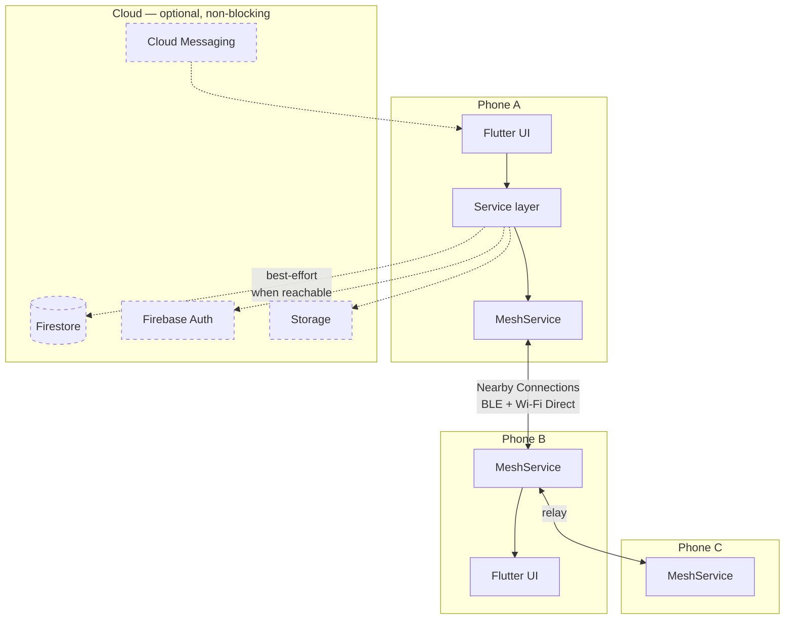
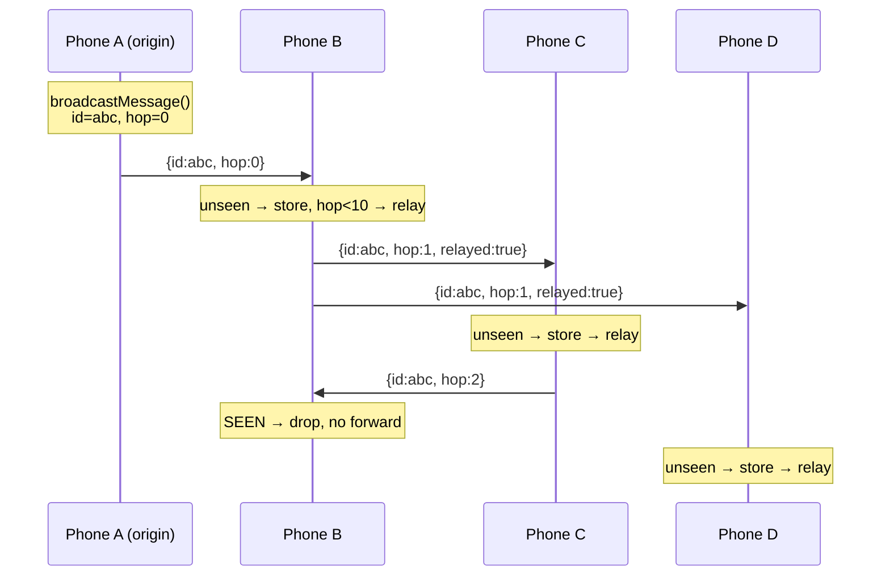
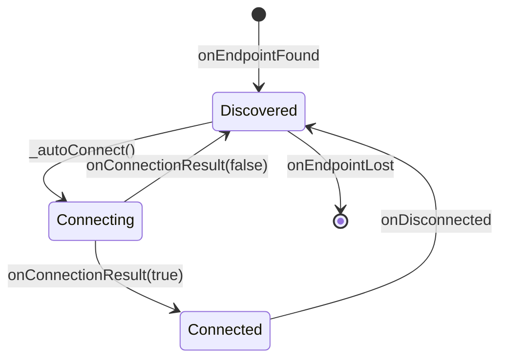
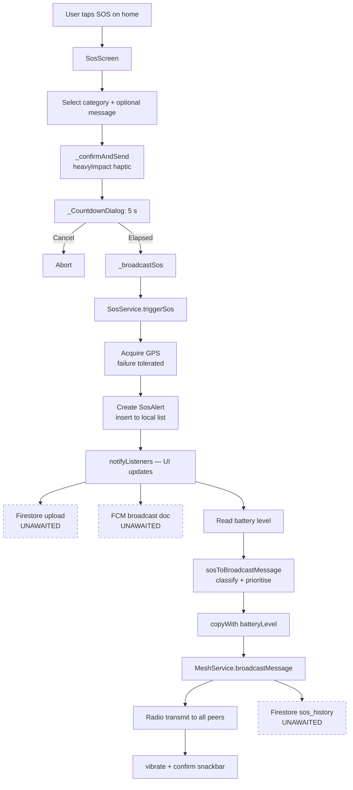

# ResQNet — Engineering Reference

> **Offline-first emergency communication for disaster response.**
> Flutter · Dart · Firebase · Google Nearby Connections
>
> This document is the complete technical reference for the project: what it does, how every
> subsystem works, **why** each architectural decision was made, and — critically — what is
> currently broken or unfinished. It is written for an engineer who has never seen this codebase
> and needs to be productive in it.

---

## Table of contents

1. [The problem and the thesis](#1-the-problem-and-the-thesis)
2. [System overview](#2-system-overview)
3. [Project layout](#3-project-layout)
4. [Architectural decisions and their rationale](#4-architectural-decisions-and-their-rationale)
5. [The domain model](#5-the-domain-model)
6. [Subsystem: the mesh network](#6-subsystem-the-mesh-network)
7. [Subsystem: SOS pipeline](#7-subsystem-sos-pipeline)
8. [Subsystem: crash detection](#8-subsystem-crash-detection)
9. [Subsystem: seismic detection](#9-subsystem-seismic-detection)
10. [Subsystem: offline maps](#10-subsystem-offline-maps)
11. [Subsystem: classification, speech and translation](#11-subsystem-classification-speech-and-translation)
12. [Subsystem: emergency contacts](#12-subsystem-emergency-contacts)
13. [Subsystem: identity and profile](#13-subsystem-identity-and-profile)
14. [Subsystem: notifications](#14-subsystem-notifications)
15. [Theming and navigation](#15-theming-and-navigation)
16. [Android platform configuration](#16-android-platform-configuration)
17. [The Gradle `compileSdk` override](#17-the-gradle-compilesdk-override)
18. [Dependency inventory](#18-dependency-inventory)
19. [Security and privacy analysis](#19-security-and-privacy-analysis)
20. [Known defects](#20-known-defects)
21. [Technical debt](#21-technical-debt)
22. [Release blockers](#22-release-blockers)
23. [Testing strategy](#23-testing-strategy)
24. [Roadmap](#24-roadmap)
25. [Build and run](#25-build-and-run)

---

## 1. The problem and the thesis

### The problem

In a disaster — monsoon flooding across Bihar, Assam and Bangladesh; landslides in the Nepali
hills; structural fires in dense urban settlements — the cellular network is among the first
systems to fail. Towers lose mains power, backhaul fibre is severed, and surviving cells are
immediately saturated by everyone trying to call at once.

This produces a cruel inversion: **the communication infrastructure is least available at
exactly the moment it is most needed.**

Every conventional emergency app — one that POSTs an alert to a server — is inert in this
scenario. It is a thin client for infrastructure that no longer exists.

### The thesis

Every smartphone in a disaster zone already carries three radios that work with no tower, no
carrier, and no internet:

| Radio | Capability |
|---|---|
| **Bluetooth / BLE** | Direct device-to-device, low power, ~10–30 m |
| **Wi-Fi Direct** | Direct device-to-device, higher bandwidth, ~100 m |
| **GNSS (GPS)** | Receive-only positioning, works anywhere with sky view |

ResQNet's premise is that the network is already in people's pockets — it is simply never used
that way. If phones relay for each other, a **multi-hop mesh** forms with no infrastructure at
all, and its reach is bounded only by the density of participants rather than by tower coverage.

### The design constraint that follows

This premise imposes one non-negotiable rule that shapes the entire codebase:

> **No life-critical path may depend on the network.**

Firebase, Google Translate, and OpenStreetMap tile servers are all present in this project, but
each is positioned strictly as an *enhancement*. Every one of them can be unreachable and the
app must still: capture GPS, compose an SOS, broadcast it over the mesh, relay other people's
messages, render a map, and dial local emergency services.

Section 20 documents where the current implementation does not fully honour this rule.

---

## 2. System overview

### Runtime topology



Dashed edges are optional. Solid edges work with the device in airplane mode.

### Layering

```
┌─────────────────────────────────────────────────────┐
│  features/          Screens and per-screen widgets   │
│                     Stateful, own only ephemeral UI  │
└────────────────────────┬────────────────────────────┘
                         │ context.watch() / read()
┌────────────────────────▼────────────────────────────┐
│  core/services/     ChangeNotifier singletons        │
│                     All business logic and I/O       │
└────────────────────────┬────────────────────────────┘
                         │
┌────────────────────────▼────────────────────────────┐
│  core/models/       Plain Dart, JSON (de)serialise   │
│                     No Flutter deps except Color     │
└─────────────────────────────────────────────────────┘
```

The dependency arrow points strictly downward. A service never imports a screen. This is what
makes the platform-specific mesh implementation swappable (§6.2) and would make the services
unit-testable if tests existed (§23).

---

## 3. Project layout

```
lib/
├── main.dart                       Composition root: Firebase init, FMTC init, DI graph
├── app.dart                        MaterialApp, themes, onboarding gate, auth gate
├── firebase_options.dart           Generated by FlutterFire CLI
│
├── core/
│   ├── constants/
│   │   ├── app_colors.dart         Static palette (dark-theme derived)
│   │   ├── app_routes.dart         Named route string constants
│   │   └── app_strings.dart        String constants
│   ├── models/
│   │   ├── emergency_message.dart  Mesh wire format + EmergencyType/PriorityLevel
│   │   ├── sos_alert.dart          Cloud/local SOS record + SosCategory/SosStatus
│   │   └── nearby_device.dart      Discovered peer
│   ├── services/
│   │   ├── mesh_service.dart           Mesh orchestration, flooding, dedup
│   │   ├── mesh_service_android.dart   Nearby Connections binding
│   │   ├── mesh_service_stub.dart      No-op fallback for unsupported platforms
│   │   ├── sos_service.dart            SOS lifecycle
│   │   ├── ai_service.dart             Classification, STT, TTS, translation
│   │   ├── location_service.dart       GPS wrapper
│   │   ├── crash_detection_service.dart  Accelerometer crash heuristic
│   │   ├── seismic_service.dart        STA/LTA tremor heuristic
│   │   ├── emergency_contacts_service.dart  Geo-fenced emergency numbers
│   │   ├── profile_service.dart        Cached medical profile
│   │   ├── notification_service.dart   FCM + local notifications
│   │   ├── theme_service.dart          Persisted theme prefs
│   │   ├── firebase_service.dart       ⚠ stub — see §20.7
│   │   ├── hazard_service.dart         ⚠ orphaned — see §21.1
│   │   └── safe_zone_service.dart      ⚠ orphaned — see §21.1
│   └── utils/
│       ├── permission_handler.dart Bulk runtime permission request
│       └── message_priority.dart   Priority → colour/label mapping
│
├── features/
│   ├── onboarding/     First-run carousel
│   ├── auth/           Phone OTP + Google Sign-In
│   ├── home/           Dashboard hub, sensor wiring
│   ├── sos/            SOS composer + 5 s countdown
│   ├── mesh/           Message feed, peer list, chat input
│   ├── map/            Offline map, region download, SOS markers
│   ├── dashboard/      Aggregate statistics
│   ├── emergency_contacts/  Geo-detected emergency numbers
│   ├── sos_history/    Firestore history + PDF export
│   ├── profile/        Medical profile editor
│   ├── crash_countdown/     20 s auto-SOS dialog
│   ├── seismic/        Earthquake alert dialog
│   └── location_trail/ ⚠ orphaned — see §21.1
│
└── widgets/
    ├── sos_button.dart      Pulsing primary action
    ├── emergency_card.dart  Message row
    ├── device_tile.dart     Peer row
    └── priority_badge.dart  Severity chip
```

**File count:** 51 Dart files, ~6,500 lines.

---

## 4. Architectural decisions and their rationale

Each decision below is recorded with the alternatives considered and the reasoning, in the style
of a lightweight ADR.

### 4.1 Flutter over native Android

**Decision.** Single Flutter codebase targeting Android first.

**Why.** The plugin ecosystem covers every hardware surface this project needs — accelerometer,
BLE/Wi-Fi Direct, GNSS, speech, TTS, camera, battery — which removes the main reason to go
native. A single UI codebase also means the eventual iOS port only has to replace the transport
layer, not the application.

**Cost accepted.** The mesh transport is *not* portable: Nearby Connections is a Google Play
Services API with no iOS equivalent. iOS needs a separate MultipeerConnectivity implementation.
This cost was made explicit in the code rather than hidden — see §6.2.

### 4.2 Provider + ChangeNotifier over BLoC/Riverpod

**Decision.** `provider` with `ChangeNotifier` services registered in a root `MultiProvider`.

**Why.** The state in this application is overwhelmingly **long-lived service state** —
"is the mesh advertising", "what is the current GPS fix", "what messages have I seen" — not
short-lived transactional UI state driven by event streams. `ChangeNotifier` models that
directly. BLoC's event/state indirection would have added ceremony without buying anything,
and Riverpod's compile-time safety matters most at a scale this project has not reached.

**Cost accepted.** `notifyListeners()` rebuilds every listening widget with no granularity.
At this screen count that is not measurable. It would become a problem with large lists and
high-frequency updates.

**Migration path.** Because all logic already lives in services behind getters, moving to
Riverpod would be mechanical.

### 4.3 Manual dependency injection at the composition root

**Decision.** `SosService` receives `AiService` and `LocationService` through its constructor,
wired by hand in `main.dart`:

```dart
final aiService = AiService();
final locationService = LocationService();

runApp(
  MultiProvider(
    providers: [
      ChangeNotifierProvider(create: (_) => aiService),
      ChangeNotifierProvider(create: (_) => locationService),
      ChangeNotifierProvider(
        create: (_) => SosService(aiService, locationService),
      ),
      // ...
    ],
```

**Why.** `SosService` genuinely depends on the *same instances* the rest of the tree observes.
Constructing them above `MultiProvider` and passing references guarantees a single instance
each, and makes the dependency explicit in the type signature rather than hidden behind a
service locator. `ProxyProvider` would achieve the same but reads worse for two dependencies.

**Consequence.** `SosService` is directly unit-testable with fakes — it has no `BuildContext`
dependency. Most other services construct their own collaborators internally and are harder
to test.

### 4.4 Firebase as enhancement, never dependency

**Decision.** Every Firebase call is fire-and-forget with an attached error handler; none is
awaited on a life-critical path.

```dart
// sos_service.dart — the alert is already in local state before this runs
_firebaseService.uploadSosAlert(alert).catchError(
      (e) => debugPrint('Firebase SOS upload error: $e'),
    );

_notificationService.broadcastSosNotification(alert).catchError(
      (e) => debugPrint('SOS notification error: $e'),
    );
```

Note the ordering in `triggerSos`: the `SosAlert` is inserted into `_alerts` and
`notifyListeners()` fires **before** any network call is attempted. The UI updates and the
mesh broadcast proceeds regardless of cloud reachability.

**Why.** Inverting this — awaiting Firestore before broadcasting — would make the app fail
precisely in the disaster scenario it exists for. This is the single most important
architectural constraint in the project.

**Same pattern in `MeshService`:**

```dart
Future<void> broadcastMessage(EmergencyMessage message) async {
  if (_seenMessageIds.contains(message.id)) return;
  _seenMessageIds.add(message.id);
  _messages.insert(0, message);
  notifyListeners();                    // 1. local state first
  final bytes = utf8.encode(jsonEncode(message.toJson()));
  _broadcastBytes(bytes);               // 2. radio second
  _saveToHistory(message);              // 3. cloud last, unawaited
}
```

### 4.5 Conditional import for platform-specific transport

**Decision.** Compile-time platform selection rather than runtime branching:

```dart
import 'mesh_service_android.dart'
    if (dart.library.html) 'mesh_service_stub.dart'
    as platform;
```

**Why.** `MeshService` orchestrates; the `platform` library binds to the transport. This keeps
all flooding, deduplication and TTL logic platform-agnostic and confines the Nearby Connections
API surface to a single 96-line file. Adding iOS means writing one more file that satisfies the
same function signatures.

**Caveat.** The condition tests `dart.library.html` (web), not iOS. On iOS the Android file is
still compiled in, and `MeshService` guards at runtime with `Platform.isAndroid`. That works
because `nearby_connections` is a no-op on iOS rather than a compile error — but the guard is
runtime, not compile-time. See §21.4.

### 4.6 Coordinate bounding boxes instead of a geocoding plugin

**Decision.** Country detection is arithmetic on latitude/longitude, not a reverse-geocoding
library.

**Context.** The original implementation used the `geocoding` package. That package's Android
artifact pinned an older `compileSdk` and **broke the entire Android build** — not a degraded
feature, a hard build failure.

**Why the replacement is better, not just a workaround.** Reverse geocoding requires a network
round-trip. In an offline-first emergency app, the feature that tells you which number to dial
for the police must not require the internet. Replacing the dependency with bounding boxes
removed a broken transitive dependency *and* made the feature work offline.

```dart
String _detectCountryFromCoords(double lat, double lng) {
  if (lat >= 8.0  && lat <= 37.6 && lng >= 68.7  && lng <= 97.4)  return 'IN';
  if (lat >= 26.3 && lat <= 30.5 && lng >= 80.0  && lng <= 88.2)  return 'NP';
  // ...
  return 'DEFAULT';
}
```

**Cost accepted, and it is real.** Boxes are rectangles; borders are not. Nepal's box
(26.3–30.5 N, 80.0–88.2 E) sits entirely inside India's box (8.0–37.6 N, 68.7–97.4 E), and
because India is tested first, **every Nepali user is currently classified as India.** See
§20.5 — this is a live bug, not a theoretical one.

### 4.7 Rule-based classification instead of on-device ML

**Decision.** `AiService.classifyEmergency` is keyword matching over a static map. There is no
model.

**Why.** A quantised TFLite text classifier would add 50–100 MB to an APK intended for
low-end devices on poor connections, introduce inference latency on the SOS path, and behave
unpredictably on the code-mixed Hindi/Nepali/English input that real users produce. Keyword
matching is instantaneous, has zero binary cost, works with no network, and — most importantly
for an emergency system — is **fully auditable**: you can read the rules and predict the output.

**Honesty requirement.** The `description` field in `pubspec.yaml` says "AI-powered". The
classifier is not AI in any meaningful sense. This should be described as *rule-based
classification* in any technical context. See §20.9 for the ordering defect it also has.

### 4.8 Explicit region pre-download for maps

**Decision.** The user downloads a 25 km radius at zoom 10–16 ahead of time; the tile provider
runs `cacheFirst`.

**Why.** A conventional HTTP cache only stores tiles already viewed. In a disaster you need the
map for the area you are fleeing *to* — which you have by definition never panned to. Reactive
caching is therefore useless here; the download must be proactive and explicit.

### 4.9 Human confirmation on every automated action

**Decision.** No sensor heuristic ever transmits without a cancellable countdown.

| Trigger | Countdown | Cancel affordance |
|---|---|---|
| Manual SOS | 5 s | "Cancel SOS" button |
| Crash detected | 20 s | "I'M OK — CANCEL" button |
| Seismic detected | n/a (alert only, no transmission) | Dismiss |

**Why.** A false emergency broadcast is not a neutral failure — it consumes responder attention,
trains users to ignore alerts, and erodes the trust the system depends on. Any accelerometer
heuristic *will* produce false positives; the countdown is the safety interlock that makes an
imperfect heuristic acceptable. The crash countdown is longer (20 s) because the user may be
disoriented after a real impact.

---

## 5. The domain model

### 5.1 `EmergencyMessage` — the mesh wire format

`lib/core/models/emergency_message.dart`

```dart
class EmergencyMessage {
  final String id;              // UUID v4 — the deduplication key
  final String senderId;
  final String senderName;
  final String message;
  final EmergencyType type;
  final PriorityLevel priority;
  final double? latitude;
  final double? longitude;
  final DateTime timestamp;
  final int hopCount;           // TTL counter, incremented on each relay
  final bool isRelayed;         // false = heard directly from origin
  final String? bloodGroup;     // medical payload — nullable for anonymous mode
  final String? allergies;
  final String? medications;
  final int? batteryLevel;      // 0–100, lets responders triage by remaining uptime
}
```

**Design notes.**

- **`id` is the deduplication key.** UUID v4 collision probability is negligible; this is what
  makes network-wide flooding terminate (§6.4).
- **`hopCount` / `isRelayed` are routing metadata carried in-band.** There is no separate
  protocol header — the message *is* the packet. This keeps the wire format to a single JSON
  object with no framing layer.
- **Medical fields are nullable by design.** Anonymous mode passes `null` rather than empty
  strings, so "not disclosed" is distinguishable from "none".
- **`batteryLevel` is a triage signal.** A critical alert from a phone at 4 % is more urgent
  than the same alert at 90 %, because that person is about to become uncontactable.
- **`timestamp` serialises as `millisecondsSinceEpoch`** (integer), not ISO-8601 — smaller on
  the wire and unambiguous across locales.

**Serialisation is hand-written**, not `json_serializable`. For a single model on the hot path
this avoids a build_runner step in the toolchain; the trade is that adding a field requires
edits in four places (constructor, `toJson`, `fromJson`, `copyWith`) and the compiler will not
catch an omission in `toJson`. See §21.5.

**`fromJson` is defensively lenient:**

```dart
type: EmergencyType.values.firstWhere(
    (e) => e.name == json['type'],
    orElse: () => EmergencyType.general),
```

An unknown enum value from a peer running a different app version degrades to `general` rather
than throwing. This is correct for a mesh where version skew is guaranteed and a parse failure
means a lost emergency message.

### 5.2 `SosAlert` — the cloud/local record

`lib/core/models/sos_alert.dart`

```dart
enum SosStatus   { active, acknowledged, resolved }
enum SosCategory { medical, fire, flood, earthquake, rescue, trapped, general }
```

`SosAlert` carries lifecycle state (`status` is mutable) and is the unit persisted to Firestore.
`EmergencyMessage` is the immutable unit transmitted over the radio. `SosService.sosToBroadcastMessage()`
converts one to the other.

**This duplication is a known design smell** — two parallel enums (`SosCategory` / `EmergencyType`)
describe the same taxonomy and must be kept in sync by hand. See §21.2.

### 5.3 `NearbyDevice`

A discovered peer: `deviceId` (Nearby endpoint ID), `deviceName` (advertised name), and a
mutable `isConnected` flag. Mutability here is deliberate — connection state changes frequently
and reallocating the object on each transition would break identity comparisons in the
`_discoveredDevices` list.

---

## 6. Subsystem: the mesh network

This is the core of the project. `lib/core/services/mesh_service.dart` (228 lines) plus
`mesh_service_android.dart` (96 lines).

### 6.1 Transport configuration

```dart
const String _serviceId = 'com.resqnet.mesh';
const Strategy _strategy = Strategy.P2P_CLUSTER;
```

**`P2P_CLUSTER`** is the critical choice. Nearby Connections offers three strategies:

| Strategy | Topology | Suitability |
|---|---|---|
| `P2P_POINT_TO_POINT` | 1:1, highest bandwidth | ✗ no relaying possible |
| `P2P_STAR` | 1 hub : N spokes | ✗ hub is a single point of failure |
| **`P2P_CLUSTER`** | **M:N arbitrary graph** | ✓ every node peers with every node |

`P2P_CLUSTER` trades per-link bandwidth for topology freedom. For emergency payloads — a few
hundred bytes of JSON — bandwidth is irrelevant and topology is everything. A star topology
would mean the mesh dies when one specific phone's battery does; a cluster degrades gracefully.

**`_serviceId`** namespaces the mesh so ResQNet devices only discover each other, not every
Nearby-enabled app in range.

### 6.2 Platform abstraction

`mesh_service_android.dart` exposes six free functions:

```dart
Future<void> startAdvertising(String userName, {...});
Future<void> startDiscovery(String userName, {...});
Future<void> acceptConnection(String endpointId, {...});
Future<void> requestConnection(String userName, String endpointId);
Future<void> sendBytes(String endpointId, Uint8List bytes);
Future<void> stopAll();
```

An iOS implementation satisfying these signatures over MultipeerConnectivity would drop in with
no change to `MeshService`. This is the seam that makes the iOS port tractable.

### 6.3 Simultaneous advertise + discover

```dart
await platform.startAdvertising(_localDeviceName, ...);
_isAdvertising = true;

await platform.startDiscovery(_localDeviceName, ...);
_isDiscovering = true;
```

Every device does **both** at once. There is no client and no server, no host election, no
coordinator. Any device can join any other at any time. This is what makes the mesh
self-healing: losing any node removes edges but never partitions the graph by role.

**Cost.** Continuous BLE advertising plus discovery is the dominant battery drain in the app.
See §21.6.

### 6.4 Flooding with deduplication — the core algorithm

Without a routing table, the only way to deliver a message to an unknown recipient is to flood
it. Naïve flooding is catastrophic: A sends to B, B rebroadcasts to A, A rebroadcasts to B,
forever, saturating the radio within seconds.

Two mechanisms make flooding viable:

```dart
void _handleIncomingPayload(Uint8List bytes) {
  try {
    final json = jsonDecode(utf8.decode(bytes)) as Map<String, dynamic>;
    final msg = EmergencyMessage.fromJson(json);

    // ── Mechanism 1: deduplication ────────────────────────
    if (_seenMessageIds.contains(msg.id)) return;   // seen it → drop, do not forward
    _seenMessageIds.add(msg.id);

    _messages.insert(0, msg);
    notifyListeners();

    // ── Mechanism 2: hop-count TTL ────────────────────────
    if (msg.hopCount < 10) {
      final relayed =
          msg.copyWith(hopCount: msg.hopCount + 1, isRelayed: true);
      _broadcastBytes(utf8.encode(jsonEncode(relayed.toJson())));
    }
  } catch (e) {
    debugPrint('Payload parse error: $e');
  }
}
```

**Mechanism 1 — UUID deduplication.** Each device keeps `Set<String> _seenMessageIds`. A message
is processed and forwarded *exactly once* per device. This is what guarantees termination:
in a graph of *N* nodes, each node forwards each message at most once, so total transmissions
are bounded by *N × degree* rather than unbounded.

**Mechanism 2 — hop-count TTL.** `hopCount < 10` caps propagation depth. This is belt-and-braces:
deduplication alone terminates flooding, but the TTL bounds blast radius if the dedup set is
ever cleared (app restart) while a message is still circulating. Ten hops at ~100 m per hop is
roughly a kilometre of reach — beyond any plausible single-incident radius.

**Propagation trace:**



The `C→B` edge is where deduplication earns its place: without it, that message re-enters
circulation and never stops.

### 6.5 Connection initiation and the tiebreak

When two devices discover each other simultaneously, both will try to connect. Nearby
Connections handles concurrent `requestConnection` calls poorly — collisions cause one or both
to fail. The intended fix is a deterministic tiebreak so exactly one side initiates:

```dart
onEndpointFound: (id, name) {
  if (!_discoveredDevices.any((d) => d.deviceId == id)) {
    _discoveredDevices.add(NearbyDevice(deviceId: id, deviceName: name));
    notifyListeners();
  }
  if (_localDeviceName.compareTo('ResQNet-$name') < 0) {
    _autoConnect(id);
  }
},
```

The idea is sound — lexicographic comparison of device names gives both sides the same answer
about who initiates, with no negotiation round-trip. **The implementation is defective on two
counts.** See §20.1 and §20.2; this is the most consequential bug in the codebase.

### 6.6 Connection state machine



`_connectingDevices` is a `Set<String>` guarding against duplicate in-flight connection attempts:

```dart
Future<void> _autoConnect(String endpointId) async {
  if (_connectedDevices.any((d) => d.deviceId == endpointId)) return;
  if (_connectingDevices.contains(endpointId)) return;   // already trying
  _connectingDevices.add(endpointId);
  // ...
}
```

`_onConnectionResult` handles the case where a connection result arrives for an endpoint not in
`_discoveredDevices` (possible if discovery dropped it mid-handshake) by synthesising a
`NearbyDevice` — a defensive path that prevents a lost peer from breaking the connected list.

### 6.7 Public API

| Member | Purpose |
|---|---|
| `startMeshNetwork()` | Begin advertise + discover (Android only; iOS sets flags) |
| `stopMeshNetwork()` | Tear down all endpoints |
| `broadcastMessage(msg)` | Originate a message |
| `addLocalMessage(msg)` | Insert without transmitting (local-only display) |
| `connectToDevice(id)` | Manual connect from the peer list UI |
| `messages` / `discoveredDevices` / `connectedDevices` | Unmodifiable views |
| `connectedCount` / `isAdvertising` / `isDiscovering` | Status for the UI |
| `isConnecting(id)` | Per-device spinner state |

All list getters return `List.unmodifiable(...)`, preventing UI code from mutating service state
— a small discipline that pays off when debugging where state changed.

---

## 7. Subsystem: SOS pipeline

### 7.1 End-to-end flow



### 7.2 The countdown interlock

`_CountdownDialog` in `sos_screen.dart`:

```dart
_timer = Timer.periodic(const Duration(seconds: 1), (t) {
  HapticFeedback.mediumImpact();       // tactile tick — usable without looking
  if (_seconds == 1) {
    t.cancel();
    if (mounted) Navigator.pop(context, true);
  } else {
    if (mounted) setState(() => _seconds--);
  }
});
```

An `AnimationController` drives a `LinearProgressIndicator` in parallel so the countdown is
legible visually and haptically. The `mounted` guards prevent `setState` after disposal if the
route is popped mid-countdown.

**Why 5 seconds.** Long enough to abort an accidental tap, short enough not to matter in a real
emergency. The crash-triggered path uses 20 s (§8.3) because the user may be concussed.

### 7.3 Graceful degradation in `triggerSos`

```dart
Position? position;
try {
  position = await _locationService.getCurrentLocation();
} catch (e) {
  debugPrint('Location fetch failed: $e');
}
```

GPS failure does **not** abort the SOS. `latitude`/`longitude` are nullable throughout the model
for exactly this reason. A message saying "I need help" with no coordinates is vastly more
useful than no message at all — a responder can still triangulate from which devices relayed it.

---

## 8. Subsystem: crash detection

`lib/core/services/crash_detection_service.dart`

### 8.1 Sensor input

```dart
_accelSub = accelerometerEventStream(
  samplingPeriod: SensorInterval.normalInterval,   // ~200 ms / 5 Hz
).listen(_onAccelerometer);
```

`accelerometerEventStream` **includes gravity** — a stationary phone reads ~9.8 m/s². This is
correct here: crash detection cares about total force, and the gravity offset is a constant
that the 40 m/s² threshold already accounts for. (The seismic service uses
`userAccelerometerEventStream`, which excludes gravity — see §9.1 for why the choice differs.)

`normalInterval` (~5 Hz) rather than `gameInterval` (~50 Hz) is a deliberate battery trade.
A crash impulse lasts 100–200 ms, so 5 Hz is marginal — this is a known sensitivity risk.

### 8.2 The detection heuristic as implemented

```dart
void _onAccelerometer(AccelerometerEvent event) {
  if (_crashDetected) return;

  final magnitude = sqrt(
    event.x * event.x + event.y * event.y + event.z * event.z,
  );

  if (magnitude > _crashThreshold && _highGTimestamp == null) {
    _highGTimestamp = DateTime.now();   // Gate 1: impact
    _captureSpeed();
  } else if (_highGTimestamp != null) {
    final elapsed = DateTime.now().difference(_highGTimestamp!);

    if (magnitude < _stillnessThreshold && elapsed.inMilliseconds < 3000) {
      _crashDetected = true;            // Gate 2: stillness → fire
      notifyListeners();
    } else if (elapsed.inSeconds > 5) {
      _highGTimestamp = null;           // timeout → reset
    }
  }
}
```

| Constant | Value | Meaning |
|---|---|---|
| `_crashThreshold` | 40.0 m/s² (≈ 4 g) | Impact magnitude |
| `_stillnessThreshold` | 12.0 m/s² | Near-rest (gravity ≈ 9.8 plus noise) |
| stillness window | 3000 ms | Impact → rest must be fast |
| reset timeout | 5 s | Spike with no rest = rough road |

**The two-gate logic.** A crash is *impact followed immediately by stillness*. A pothole
produces impact followed by continued motion. Requiring both discriminates between them.

### 8.3 Response

`HomeScreen` subscribes and presents `CrashCountdownDialog` — 20 seconds, `barrierDismissible: false`,
with a re-entrancy guard so the dialog cannot stack:

```dart
crashService.addListener(() {
  if (crashService.crashDetected && mounted && !_crashDialogOpen) {
    _crashDialogOpen = true;
    showDialog(
      context: context,
      barrierDismissible: false,
      builder: (_) => const CrashCountdownDialog(),
    ).then((_) => _crashDialogOpen = false);
  }
});
```

### 8.4 ⚠ The speed gate is captured but never enforced

`_captureSpeed()` reads GPS speed and stores it in `_speedAtImpact`:

```dart
Future<void> _captureSpeed() async {
  try {
    final pos = await Geolocator.getLastKnownPosition();
    if (pos != null && pos.speed > 0) {
      _speedAtImpact = pos.speed * 3.6;   // m/s → km/h
    }
  } catch (_) {
    _speedAtImpact = 0.0;
  }
}
```

**That value is used only for display. It gates nothing.** The consequence is that dropping the
phone onto a hard surface satisfies both gates — sharp impact, then stillness — and triggers a
false crash alert. This is a live defect, documented in §20.3 with the fix.

---

## 9. Subsystem: seismic detection

`lib/core/services/seismic_service.dart`

### 9.1 STA/LTA — the standard seismological trigger

The algorithm is **Short-Term Average / Long-Term Average**, the classic seismometer trigger.
It compares recent energy against the rolling background to detect an anomaly, which makes it
self-calibrating: it adapts to whatever ambient vibration the phone's environment has.

```dart
static const int _shortWindow = 20;          // ~1 s at 50 Hz
static const int _longWindow  = 200;         // ~10 s
static const double _triggerRatio = 4.0;
static const double _stationaryThreshold = 0.3;
```

```dart
_sub = userAccelerometerEventStream(
  samplingPeriod: SensorInterval.gameInterval,   // ~20 ms / 50 Hz
).listen(_onSample);
```

**`userAccelerometerEventStream` excludes gravity** — unlike crash detection. Correct here:
ground motion is what matters, and a constant 9.8 m/s² offset would dominate both averages and
compress the ratio toward 1.

```dart
final lta = list.reduce((a, b) => a + b) / list.length;

_isStationary = lta < _stationaryThreshold;
if (!_isStationary) return;                    // only monitor a resting phone

final recent = list.sublist(list.length - _shortWindow);
final sta = recent.reduce((a, b) => a + b) / recent.length;

final ratio = sta / max(lta, 0.02);            // floor guards divide-by-zero

if (ratio > _triggerRatio && !_quakeDetected) { ... }
```

### 9.2 Guard conditions

- **Stationary gate.** `lta < 0.3` means the phone must be resting. A phone in a pocket or hand
  produces motion that would swamp any seismic signal.
- **Refractory period.** No re-alert within 120 s of the previous one.
- **Buffer warm-up.** No evaluation until 200 samples (~10 s) are collected.

### 9.3 ⚠ Sensitivity is miscalibrated

Field testing showed the detector firing on ordinary desk bumps. The cause is arithmetic:

On a still phone the LTA is very small — on the order of 0.01–0.02 m/s². The
`max(lta, 0.02)` floor clamps the denominator at 0.02. Triggering at ratio > 4 therefore
requires an STA of only **0.08 m/s²** — an imperceptible tap.

The intended behaviour (a quiet baseline making the detector *more* discriminating) is inverted
by the floor: the quieter the environment, the more trivially the threshold is crossed.

This is why the feature is slated for removal — see §20.4. The algorithm is correct; a
single-phone MEMS accelerometer is simply not the right instrument, and no threshold reliably
separates a P-wave from a desk bump on this hardware.

---

## 10. Subsystem: offline maps

`lib/features/map/map_screen.dart`

### 10.1 Stack

| Layer | Package | Role |
|---|---|---|
| Renderer | `flutter_map` ^7.0.2 | Leaflet-style tile map |
| Cache | `flutter_map_tile_caching` ^9.1.0 | Persistent tile store + bulk download |
| Storage | ObjectBox (FMTC's backend) | On-device tile database |
| Tiles | OpenStreetMap | Free, no API key, redistributable |

**Why OSM.** Google Maps' terms prohibit offline tile caching and require a billed API key.
OSM permits bulk download for personal/offline use, which is a hard requirement here.

### 10.2 Initialisation ordering

```dart
void main() async {
  WidgetsFlutterBinding.ensureInitialized();
  await Firebase.initializeApp(options: DefaultFirebaseOptions.currentPlatform);

  await FMTCObjectBoxBackend().initialise();
  await const FMTCStore('mapStore').manage.create();
  // ...
}
```

Both are `await`ed before `runApp`. FMTC's ObjectBox backend must be open before any tile
provider is constructed, and `manage.create()` is idempotent — safe on every launch.

### 10.3 Region download

```dart
final downloadable = CircleRegion(center, 25).toDownloadable(
  minZoom: 10,
  maxZoom: 16,
  options: TileLayer(
    urlTemplate: _tileUrl,
    userAgentPackageName: 'com.resqnet.app',
  ),
);

final progressStream = const FMTCStore('mapStore').download.startForeground(
  region: downloadable,
  parallelThreads: 5,
  maxBufferLength: 200,
  skipExistingTiles: true,
  skipSeaTiles: true,
);

await for (final event in progressStream) {
  if (mounted) {
    setState(() => _downloadProgress = event.percentageProgress / 100);
  }
}
```

**Parameter rationale.**

- **25 km radius** — covers a city and its evacuation hinterland.
- **Zoom 10–16** — 10 is regional orientation, 16 is street level. Zoom 17+ quadruples tile
  count per level for detail that matters little when navigating on foot.
- **`parallelThreads: 5`** — OSM's tile usage policy discourages heavy parallel scraping;
  5 is courteous and still fast.
- **`skipSeaTiles: true`** — open-water tiles are uniform blue and compress to near-nothing of
  value; skipping them is a large saving in coastal regions.
- **`skipExistingTiles: true`** — makes re-download incremental.
- **`userAgentPackageName`** — OSM policy requires identifying the client. Omitting it risks
  being blocked.

### 10.4 Cache-first read path

```dart
tileProvider: const FMTCStore('mapStore').getTileProvider(
  settings: FMTCTileProviderSettings(
    behavior: CacheBehavior.cacheFirst,
  ),
),
```

`cacheFirst` consults local storage before the network on **every** tile request — not just
when offline. This means the map is fast and zero-data even when connectivity exists, and the
offline path is exercised constantly rather than only in the rare case, so it cannot silently rot.

### 10.5 Connectivity indicator

```dart
Future<void> _checkConnectivity() async {
  try {
    final result = await InternetAddress.lookup('tile.openstreetmap.org')
        .timeout(const Duration(seconds: 3));
    setState(() => _isOffline = result.isEmpty || result[0].rawAddress.isEmpty);
  } catch (_) {
    setState(() => _isOffline = true);
  }
}
```

A DNS lookup against the actual tile host, not a generic reachability check — it tests the
dependency that matters. It runs once in `initState` and is not re-polled; the banner can
therefore be stale. Minor, and noted in §21.7.

### 10.6 Markers

Current position renders as a blue `my_location` icon; every mesh message with coordinates
renders as a red warning triangle, tappable for a bottom-sheet detail view. Messages without
coordinates are filtered out rather than dropped at a default position — showing a phantom
marker at (0, 0) would be actively misleading.

---

## 11. Subsystem: classification, speech and translation

`lib/core/services/ai_service.dart`

### 11.1 Classification

```dart
static const Map<EmergencyType, List<String>> _keywords = {
  EmergencyType.medical: ['heart','blood','injury','hospital','pain',
      'unconscious','breathing','medical','doctor','ambulance','wounded'],
  EmergencyType.fire:    ['fire','burning','smoke','flame','blaze','explosion'],
  EmergencyType.flood:   ['flood','water','drowning','submerged','rain','river','overflow'],
  EmergencyType.earthquake: ['earthquake','tremor','quake','collapse','rubble','building fell'],
  EmergencyType.trapped: ['trapped','stuck','buried','cannot move','pinned'],
  EmergencyType.rescue:  ['rescue','help','missing','lost','save me'],
};

EmergencyType classifyEmergency(String message) {
  final lower = message.toLowerCase();
  for (final entry in _keywords.entries) {
    for (final keyword in entry.value) {
      if (lower.contains(keyword)) return entry.key;
    }
  }
  return EmergencyType.general;
}
```

Substring matching, first hit wins, iterating in map insertion order. Priority assessment
follows the same pattern with a fallback:

```dart
PriorityLevel assessPriority(String message, EmergencyType type) {
  // ... keyword scan ...
  if (type == EmergencyType.medical || type == EmergencyType.fire) {
    return PriorityLevel.high;      // structural fallback when no keyword matched
  }
  return PriorityLevel.medium;
}
```

The fallback encodes domain judgement: an unclassified medical or fire report defaults to high
priority because the cost of under-triaging those is asymmetric.

**Defects:** ordering-dependent misclassification and substring false positives — §20.9.

### 11.2 Static first-aid guidance

`generateSuggestion(EmergencyType)` returns a constant string per category — "Drop, Cover, Hold
On" for earthquake, "Move to higher ground immediately" for flood, and so on. Compile-time
constants, so it works with no network and cannot fail.

### 11.3 Speech-to-text

```dart
_speech.listen(
  onResult: (result) {
    if (result.finalResult) { onResult(result.recognizedWords); ... }
  },
  listenFor: const Duration(seconds: 30),
  pauseFor: const Duration(seconds: 5),
  localeId: _getLocaleId(language),
);
```

Only `finalResult` is consumed — interim hypotheses would cause the text field to flicker.
Voice input matters disproportionately here: a user with injured hands, in darkness, or in panic
may be unable to type.

### 11.4 Translation — ⚠ the one online-only feature

```dart
Future<String> translateMessage(String text, String targetLanguage) async {
  try {
    final translation = await _translator.translate(text, to: targetLanguage);
    return translation.text;
  } catch (e) {
    debugPrint('Translation error: $e');
    return text;                       // graceful: original text on failure
  }
}
```

The `translator` package scrapes Google Translate's undocumented web endpoint. It **requires
internet** and can break without notice if Google changes the endpoint.

The failure mode is correct — the original text is returned rather than an error — so the
message is always readable. But translation is the single feature that violates the offline-first
principle, and that should be stated plainly rather than glossed. See §21.8.

### 11.5 Language support

Ten languages are declared: English, Hindi, Nepali, Bengali, Tamil, Telugu, Marathi, Gujarati,
Punjabi, Arabic — each mapped to both an ISO code (translation) and a locale ID (speech).

The intended scope reduction is to **English, Hindi, Nepali** — the three languages matching the
actual target deployment, and the three whose STT models are most reliably present on
target-market devices. That change is pending in `supportedLanguages` and `_speechLocales`.

---

## 12. Subsystem: emergency contacts

`lib/core/services/emergency_contacts_service.dart`

A static table of verified emergency numbers for eight countries plus an international fallback:

| Code | Country | Numbers |
|---|---|---|
| IN | India | 100 police · 102 ambulance · 101 fire · 108 disaster · 1091 women · 1098 child |
| NP | Nepal | 100 · 102 · 101 · 1144 disaster relief · 103 armed police |
| US | United States | 911 · FEMA · poison control · 988 crisis |
| GB | United Kingdom | 999 · 101 non-emergency · 111 NHS |
| AU | Australia | 000 · 131 444 · 132 500 SES |
| AE | UAE | 999 · 998 · 997 |
| PK | Pakistan | 15 · 1122 · 16 |
| BD | Bangladesh | 999 · 9555555 · 199 |
| — | Fallback | 112 (GSM universal) · 911 |

`112` as the fallback is deliberate: it is mandated by the GSM standard and routes to local
emergency services in most of the world, even from a locked phone with no SIM.

Dialling uses `url_launcher` with a `tel:` URI. `AndroidManifest.xml` declares the corresponding
`<queries>` intent so package visibility on Android 11+ does not block it:

```xml
<intent>
    <action android:name="android.intent.action.DIAL"/>
    <data android:scheme="tel"/>
</intent>
```

Without that declaration `canLaunchUrl` returns false on API 30+ and the call button silently
does nothing — a non-obvious platform requirement worth knowing.

**Bugs:** Nepal is unreachable due to box ordering (§20.5), and the GPS acquisition has no
timeout (§20.6).

---

## 13. Subsystem: identity and profile

### 13.1 Authentication

`features/auth/auth_service.dart` supports two methods:

- **Phone OTP** — `verifyPhoneNumber` → `codeSent` → `PhoneAuthProvider.credential` →
  `signInWithCredential`. Includes `verificationCompleted` for Android's SMS auto-retrieval,
  which signs the user in without manual entry.
- **Google Sign-In** — standard OAuth credential exchange.

**Why phone-first.** In the target market, phone numbers are near-universal identity while email
is not. A phone number also doubles as a reachable emergency contact.

### 13.2 Auth gating

`app.dart` composes two gates:

```dart
home: FutureBuilder<bool>(
  future: SharedPreferences.getInstance()
      .then((p) => p.getBool('onboarding_done') ?? false),
  builder: (context, snap) {
    if (!snap.hasData) return /* spinner */;
    if (snap.data == false) return OnboardingScreen(onDone: ...);
    return const _AuthGate();
  },
),
```

`_AuthGate` then wraps a `StreamBuilder<User?>` on `authStateChanges()`, with
`initialData: FirebaseAuth.instance.currentUser` — so a returning user renders `HomeScreen`
on the first frame instead of flashing a spinner.

### 13.3 Medical profile

`ProfileService` caches the Firestore `user_profiles/{uid}` document in memory: name, blood
group, allergies, medications, emergency contact, photo URL.

```dart
final doc = await FirebaseFirestore.instance
    .collection('user_profiles').doc(uid).get()
    .timeout(const Duration(seconds: 8));
```

**The 8-second timeout is important.** Firestore's SDK will otherwise hang indefinitely on a
degraded connection. Bounding it means a slow network delays profile enrichment but never
blocks the UI.

Blood group, allergies and medications ride along on every SOS — the information a paramedic
needs before the patient can speak. Anonymous mode passes `null` for all three.

---

## 14. Subsystem: notifications

`lib/core/services/notification_service.dart`

Singleton (`factory NotificationService() => _instance`) that combines FCM with
`flutter_local_notifications`.

### 14.1 Channel configuration

```dart
static const AndroidNotificationChannel _channel = AndroidNotificationChannel(
  'resqnet_emergency',
  'Emergency Alerts',
  description: 'Critical emergency notifications from ResQNet',
  importance: Importance.max,
  playSound: true,
  enableVibration: true,
);
```

`Importance.max` requests heads-up presentation. On Android 8+, channel importance is fixed at
creation time and cannot be raised later — getting it right on first install matters.

### 14.2 Background isolate handler

```dart
@pragma('vm:entry-point')
Future<void> firebaseMessagingBackgroundHandler(RemoteMessage message) async { ... }
```

`@pragma('vm:entry-point')` prevents tree-shaking in release builds. Without it the handler is
stripped and background notifications silently stop working in release only — a classic
release-only failure. The handler runs in a **separate isolate** with no access to app state,
which is why it re-initialises its own `FlutterLocalNotificationsPlugin` instance.

### 14.3 Token management

FCM tokens are persisted to `user_tokens/{uid}` and refreshed via `onTokenRefresh`, so a token
rotation does not orphan the device.

### 14.4 ⚠ Server-side fan-out is not implemented

```dart
Future<void> broadcastSosNotification(SosAlert alert) async {
  await FirebaseFirestore.instance.collection('sos_broadcasts').doc(alert.id).set({
    // ...
    'notificationSent': false,
  });
}
```

The `notificationSent: false` flag implies a Cloud Function watches this collection and fans out
FCM messages. **That function does not exist.** `resqnet/index.js` is the unmodified Firebase
Functions scaffold with every export commented out.

Consequence: documents accumulate in `sos_broadcasts` and no push notification is ever
delivered. See §20.8.

---

## 15. Theming and navigation

### 15.1 Theming

`ThemeService` persists two independent axes to `SharedPreferences`:

- **Mode** — dark (default) / light, key `is_dark_mode`
- **Accent** — six presets, key `theme_color`

```dart
static const Map<String, Color> availableThemes = {
  'Emergency Red':   Color(0xFFD32F2F),
  'Rescue Orange':   Color(0xFFE65100),
  'Alert Blue':      Color(0xFF1565C0),
  'Safe Green':      Color(0xFF2E7D32),
  'Warning Purple':  Color(0xFF6A1B9A),
  'Night Teal':      Color(0xFF00695C),
};
```

**Dark default is a domain decision, not a style preference.** In a disaster, screen brightness
is battery, and battery is survival time. Dark UI on OLED panels measurably extends it, and
preserves night vision in an unlit environment.

`app.dart` builds `_darkTheme(primary)` / `_lightTheme(primary)` and injects the accent into
`ColorScheme`, buttons, FAB and switches, so one preference propagates everywhere.

**Inconsistency:** `AppColors` hard-codes dark-theme values (`backgroundDark`, `surfaceDark`,
`cardDark`) and several screens reference them directly, bypassing `Theme.of(context)`.
Those screens do not respond to the light-mode toggle. See §21.3.

### 15.2 Navigation

Hybrid, and deliberately so:

```dart
routes: {
  AppRoutes.sos:       (_) => const SosScreen(),
  AppRoutes.mesh:      (_) => const MeshScreen(),
  AppRoutes.map:       (_) => const MapScreen(),
  AppRoutes.dashboard: (_) => const DashboardScreen(),
},
```

Named routes for the four hub destinations reachable from multiple places; inline
`MaterialPageRoute` for leaf screens (profile, contacts, history) that are only reachable from
one place. Registering a leaf screen as a named route adds indirection with no benefit.

---

## 16. Android platform configuration

### 16.1 Permissions

```xml
<uses-permission android:name="android.permission.RECORD_AUDIO"/>
<uses-permission android:name="android.permission.INTERNET"/>
<uses-permission android:name="android.permission.ACCESS_FINE_LOCATION"/>
<uses-permission android:name="android.permission.ACCESS_COARSE_LOCATION"/>
<uses-permission android:name="android.permission.BLUETOOTH"/>
<uses-permission android:name="android.permission.BLUETOOTH_ADMIN"/>
<uses-permission android:name="android.permission.BLUETOOTH_SCAN"/>
<uses-permission android:name="android.permission.BLUETOOTH_CONNECT"/>
<uses-permission android:name="android.permission.BLUETOOTH_ADVERTISE"/>
<uses-permission android:name="android.permission.ACCESS_WIFI_STATE"/>
<uses-permission android:name="android.permission.CHANGE_WIFI_STATE"/>
<uses-permission android:name="android.permission.NEARBY_WIFI_DEVICES"/>
<uses-permission android:name="android.permission.POST_NOTIFICATIONS"/>
```

**`ACCESS_FINE_LOCATION` is required for BLE scanning**, not only for GPS. Android treats BLE
scan results as location-inferring data. This surprises people and is worth understanding before
attempting to reduce the permission set.

`NEARBY_WIFI_DEVICES` (API 33+) and the granular `BLUETOOTH_SCAN` / `_CONNECT` / `_ADVERTISE`
(API 31+) are the modern replacements for the legacy blanket Bluetooth permissions, which are
retained for older devices.

### 16.2 Build configuration

```kotlin
android {
    namespace = "com.example.resqnet"
    compileSdk = 36
    ndkVersion = "28.2.13676358"

    compileOptions {
        isCoreLibraryDesugaringEnabled = true      // flutter_local_notifications needs java.time
        sourceCompatibility = JavaVersion.VERSION_1_8
        targetCompatibility = JavaVersion.VERSION_1_8
    }

    defaultConfig {
        applicationId = "com.example.resqnet"      // ⚠ release blocker — §22.1
        targetSdk = 36
        multiDexEnabled = true                     // dependency count exceeds 65 k methods
    }

    buildTypes {
        release {
            signingConfig = signingConfigs.getByName("debug")   // ⚠ release blocker — §22.2
        }
    }
}
```

- **Core library desugaring** is mandatory for `flutter_local_notifications`, which uses
  `java.time` APIs unavailable below API 26.
- **MultiDex** is required because Firebase + Nearby + maps + ML plugins together exceed the
  65,536-method DEX limit.

---

## 17. The Gradle `compileSdk` override

`android/build.gradle.kts` contains the least obvious code in the repository. It deserves a
full explanation because it looks like a hack and is easy to "clean up" into a broken state.

### The problem

`flutter_map_tile_caching` depends transitively on `objectbox_flutter_libs`, whose own
`build.gradle` hard-codes an older `compileSdk`. That module then pulls AndroidX artifacts
(`androidx.fragment:1.7.1`, `androidx.window:1.2.0`, `androidx.core:1.13.1`, …) which declare
AAR metadata requiring **compileSdk 34+**.

The result is a hard build failure listing 20 separate AAR metadata violations, all of the form:

```
Dependency 'androidx.fragment:fragment:1.7.1' requires libraries and applications
that depend on it to compile against version 34 or later of the Android APIs.
:objectbox_flutter_libs is currently compiled against android-31.
```

The app module already sets `compileSdk = 36`. That does not help — each library module compiles
against its own setting.

### First attempt, and why it was insufficient

```kotlin
allprojects {
    plugins.withId("com.android.library") {
        extensions.configure<com.android.build.gradle.LibraryExtension> {
            compileSdk = 36
        }
    }
}
```

`plugins.withId` fires when the plugin is applied — *before* the module's own build script runs.
The plugin's later `compileSdk = 31` assignment therefore overwrites this. The block runs too
early to win.

### The working fix

```kotlin
subprojects {
    project.buildDir = file("${rootProject.buildDir}/${project.name}")
    project.evaluationDependsOn(":app")

    val forceCompileSdk: (org.gradle.api.Project) -> Unit = { p ->
        p.extensions.findByType(com.android.build.gradle.LibraryExtension::class.java)?.apply {
            compileSdk = 36
        }
    }
    if (state.executed) {
        forceCompileSdk(this)
    } else {
        afterEvaluate { forceCompileSdk(this) }
    }
}
```

`afterEvaluate` runs **after** the module's build script has finished, so the override lands last
and wins.

### Why the `state.executed` guard exists

`project.evaluationDependsOn(":app")` forces `:app` to evaluate first. Consequently, by the time
the `subprojects` block reaches `:app` itself, that project is already evaluated — and calling
`afterEvaluate` on an already-evaluated project throws:

```
Cannot run Project.afterEvaluate(Action) when the project is already evaluated.
```

The guard branches on `state.executed`: apply immediately if evaluation is done, otherwise defer.
Both paths call the same lambda.

### Maintenance note

Remove this block when `objectbox_flutter_libs` ships a build with `compileSdk ≥ 34` and the
dependency tree is updated. Until then it is load-bearing — deleting it breaks the Android build
entirely.

---

## 18. Dependency inventory

| Package | Version | Purpose | Offline? |
|---|---|---|---|
| `provider` | ^6.1.1 | State management | ✅ |
| `nearby_connections` | ^4.0.0 | **Mesh transport** | ✅ |
| `geolocator` | ^11.0.0 | GPS | ✅ |
| `sensors_plus` | ^4.0.2 | Accelerometer | ✅ |
| `battery_plus` | ^6.0.1 | Battery level | ✅ |
| `flutter_map` | ^7.0.2 | Map rendering | ✅ |
| `flutter_map_tile_caching` | ^9.1.0 | Tile persistence + bulk download | ✅ |
| `latlong2` | ^0.9.0 | Geo primitives | ✅ |
| `shared_preferences` | ^2.2.3 | Local key-value store | ✅ |
| `speech_to_text` | ^7.0.0 | Voice input | ✅¹ |
| `flutter_tts` | ^4.2.0 | Voice output | ✅¹ |
| `url_launcher` | ^6.3.0 | `tel:` dialling | ✅ |
| `permission_handler` | ^11.3.0 | Runtime permissions | ✅ |
| `flutter_local_notifications` | ^17.2.2 | Local alerts | ✅ |
| `uuid` | ^4.3.3 | Message IDs | ✅ |
| `intl` | ^0.19.0 | Date formatting | ✅ |
| `pdf` / `printing` | ^3.10.8 / ^5.12.0 | History export | ✅ |
| `qr_flutter` | ^4.1.0 | QR generation | ✅ |
| `image_picker` | ^1.1.2 | Profile photo | ✅ |
| `pinput` | ^5.0.0 | OTP entry UI | ✅ |
| `translator` | ^1.0.0 | Translation | ❌ **network required** |
| `firebase_core` | ^3.6.0 | Firebase base | ❌ |
| `firebase_auth` | ^5.3.0 | Authentication | ❌ |
| `cloud_firestore` | ^5.4.0 | Profiles, history | ⚠ offline cache only |
| `firebase_messaging` | ^15.1.0 | Push | ❌ |
| `firebase_storage` | ^12.3.2 | Profile photos | ❌ |
| `google_sign_in` | ^6.2.1 | OAuth | ❌ |
| `cached_network_image` | ^3.3.1 | Image cache | ⚠ unused after FMTC migration |

¹ Depends on device-local STT/TTS engines. Most Android devices bundle offline models for major
languages; coverage for Nepali is not guaranteed.

**23 of 27 runtime packages work fully offline.** The Firebase cluster and `translator` are the
exceptions, and all sit on non-critical paths — except translation, which is a genuine gap.

---

## 19. Security and privacy analysis

### 19.1 Threat model

| Asset | Exposure | Current mitigation |
|---|---|---|
| Medical data (blood group, allergies, medications) | Broadcast in cleartext over mesh | Anonymous mode omits it |
| Live GPS coordinates | Broadcast in cleartext over mesh | Only sent on explicit user action |
| Identity (name) | Broadcast in cleartext | Anonymous mode substitutes "Anonymous" |
| Firestore records | Server-side | Firebase Auth + security rules |

### 19.2 What is protected

- **Transport encryption between adjacent peers.** Nearby Connections encrypts each
  point-to-point link.
- **No background location tracking.** Position is read on explicit SOS, "I am safe", or map
  interaction. There is no persistent tracking loop.
- **Anonymous mode.** Strips name and all three medical fields at message construction, so the
  data never reaches the wire.
- **Bounded profile fetch.** The 8-second Firestore timeout prevents a hung request from
  becoming a denial of service against the UI.

### 19.3 What is not protected

**No end-to-end encryption.** Payloads are plaintext JSON. Nearby Connections protects hop A→B,
but B decrypts, deserialises, re-serialises and re-encrypts for B→C. **Every relaying device can
read the full payload**, including medical data and precise coordinates. In a multi-hop mesh
this means an arbitrary stranger's phone reads your blood type and location.

**No message authentication.** `senderId` and `senderName` are attacker-controlled strings.
Anyone running a modified client can:

- forge messages attributed to another person;
- inject false SOS alerts at arbitrary coordinates to misdirect responders;
- flood the network with unique UUIDs, defeating deduplication (each is legitimately new) and
  exhausting radio time and the unbounded `_seenMessageIds` set (§20.10).

**No replay protection.** A captured payload can be rebroadcast later; only the local dedup set
prevents re-acceptance, and that set does not survive an app restart.

### 19.4 Recommended remediation

1. **Sign messages.** Ed25519 keypair per install; public key exchanged on first contact.
   Signature covers all immutable fields (`hopCount` and `isRelayed` must be excluded, since
   relays legitimately modify them). Defeats forgery and replay.
2. **Encrypt the sensitive subset.** Split the payload: routing metadata in cleartext so relays
   can function, medical fields encrypted to intended recipients.
3. **Rate-limit by sender key.** Bounds flooding once identity is authenticated.
4. **Bound the dedup set.** Time-windowed or LRU eviction (§20.10).

This is the highest-value work remaining on the project.

---

## 20. Known defects

Ordered by severity. Each entry states the symptom, the mechanism, and the fix.

---

### 20.1 🔴 `setDeviceName()` is never called

**Symptom.** Every device advertises the identical name `ResQNet-Device`. The peer list shows
indistinguishable entries, and the connection tiebreak (§20.2) cannot function.

**Mechanism.** `MeshService.setDeviceName()` is defined and never invoked anywhere in the
codebase — verified by full-tree grep. `_localDeviceName` retains its initialiser:

```dart
String _localDeviceName = 'ResQNet-Device';

void setDeviceName(String name) {          // ← zero call sites
  _localDeviceName = 'ResQNet-$name';
}
```

**Fix.** Call it once the profile is available, before starting the mesh — in `HomeScreen._init()`:

```dart
final profile = context.read<ProfileService>();
await profile.loadProfile();
final mesh = context.read<MeshService>();
mesh.setDeviceName(
  profile.name.isNotEmpty
      ? profile.name
      : FirebaseAuth.instance.currentUser?.uid.substring(0, 6) ?? 'Anon',
);
await mesh.startMeshNetwork();
```

Falling back to a UID prefix guarantees uniqueness even before a profile exists.

---

### 20.2 🔴 Double-prefix defeats the connection tiebreak

**Symptom.** Both devices in a pair initiate connection simultaneously, causing collisions,
failed handshakes, and flaky pairing.

**Mechanism.** `_localDeviceName` **already contains** the `ResQNet-` prefix. The remote's
advertised `name` therefore also already contains it. The comparison adds the prefix a second
time:

```dart
if (_localDeviceName.compareTo('ResQNet-$name') < 0) {
  _autoConnect(id);
}
```

Concretely, with both devices at default name:

- Local: `"ResQNet-Device"`
- Remote advertises: `"ResQNet-Device"`
- Compared against: `"ResQNet-ResQNet-Device"` ← double prefix

`"ResQNet-Device".compareTo("ResQNet-ResQNet-Device")` compares at index 8: `'D'` (68) vs
`'R'` (82). `'D' < 'R'`, so the result is negative — **true on both devices**. Both initiate.

The tiebreak is not merely broken by the naming bug in §20.1; it is inverted into always-true by
the double prefix.

**Fix.** Compare against the raw advertised name:

```dart
if (_localDeviceName.compareTo(name) < 0) {
  _autoConnect(id);
}
```

Both fixes (§20.1 and §20.2) are required together. Unique names alone do not help while the
comparison is malformed; fixing the comparison alone does not help while all names are identical
(`compareTo` returns 0, so *neither* side connects).

---

### 20.3 🔴 Crash detection has no speed gate — phone drops trigger false alerts

**Symptom.** Dropping the phone onto a hard surface produces a full-screen crash alert with a
20-second auto-SOS countdown. Reproducible on a desk.

**Mechanism.** A drop satisfies both implemented gates: sharp impact above 40 m/s², then
stillness within 3 s. `_captureSpeed()` records GPS speed into `_speedAtImpact` but **no branch
ever tests it** — the value is used only for display in the dialog.

**Fix.** Add a third gate requiring the device to have been travelling at vehicle speed.

```dart
class CrashDetectionService extends ChangeNotifier {
  static const double _crashThreshold     = 45.0;   // ≈4.5 g, slightly stricter
  static const double _stillnessThreshold = 12.0;
  static const double _minDrivingSpeed    = 5.5;    // m/s ≈ 20 km/h

  bool _confirming = false;
  bool _wasDriving = false;
  Future<void>? _speedCheck;

  void _onAccelerometer(AccelerometerEvent event) {
    if (_crashDetected || _confirming) return;

    final magnitude = sqrt(event.x*event.x + event.y*event.y + event.z*event.z);

    if (magnitude > _crashThreshold && _highGTimestamp == null) {
      _highGTimestamp = DateTime.now();
      _speedCheck = _checkSpeed();               // start GPS read immediately
    } else if (_highGTimestamp != null) {
      final elapsed = DateTime.now().difference(_highGTimestamp!);
      if (magnitude < _stillnessThreshold && elapsed.inMilliseconds < 3000) {
        _confirmCrash();                         // gate 3 before firing
      } else if (elapsed.inSeconds > 5) {
        _highGTimestamp = null;
      }
    }
  }

  Future<void> _checkSpeed() async {
    _wasDriving = false;
    _speedAtImpact = 0.0;
    try {
      final pos = await Geolocator.getLastKnownPosition();
      if (pos != null && pos.speed > _minDrivingSpeed) {
        _wasDriving = true;
        _speedAtImpact = pos.speed * 3.6;
      }
    } catch (_) {}
  }

  Future<void> _confirmCrash() async {
    _confirming = true;
    try {
      await _speedCheck;                         // await the async GPS read
      if (_wasDriving) {
        _crashDetected = true;
        notifyListeners();
      } else {
        _highGTimestamp = null;                  // drop / throw — discard
      }
    } finally {
      if (!_crashDetected) _confirming = false;
    }
  }
}
```

A dropped phone reads GPS speed ≈ 0 and is discarded. A genuine vehicle crash reads > 20 km/h
and proceeds. The `_confirming` flag prevents re-entry while the async speed check is in flight.

**Residual limitation.** `getLastKnownPosition()` may return a stale fix. A more robust
implementation would maintain a rolling speed buffer from `getPositionStream` so the speed at
impact is always fresh.

---

### 20.4 🟠 Seismic detection fires on ordinary vibration

**Symptom.** Desk bumps and footsteps trigger the full-screen earthquake alert.

**Mechanism.** Analysed in §9.3. The `max(lta, 0.02)` denominator floor means an STA of only
0.08 m/s² clears the ratio-4 threshold on a quiet surface.

**Assessment.** This is not tunable to reliability. A single MEMS accelerometer at 50 Hz cannot
separate a seismic P-wave from local mechanical noise; real earthquake early-warning systems
(Japan's, and Android's) rely on **correlated detection across thousands of devices**, not on any
single sensor. A false earthquake alarm is severe — it can cause panic and injury.

**Resolution.** Remove the feature. Files: `seismic_service.dart`,
`features/seismic/earthquake_alert_dialog.dart`, and the wiring in `main.dart` (provider
registration) and `home_screen.dart` (import, `_quakeDialogOpen`, listener block).

---

### 20.5 🟠 Nepal is unreachable in country detection

**Symptom.** A user in Kathmandu receives India's emergency numbers. Nepal's disaster relief
line (1144) and armed police (103) are never shown.

**Mechanism.** India's bounding box fully contains Nepal's, and India is tested first:

```dart
if (lat >= 8.0  && lat <= 37.6 && lng >= 68.7 && lng <= 97.4) return 'IN';  // contains NP
if (lat >= 26.3 && lat <= 30.5 && lng >= 80.0 && lng <= 88.2) return 'NP';  // unreachable
```

Kathmandu (27.7 N, 85.3 E) satisfies the India predicate. The same defect affects Pakistan
(box 23.6–37.1 N, 60.9–77.8 E), which overlaps India's western extent.

**Fix.** Order tests from smallest/most specific box to largest.

```dart
String _detectCountryFromCoords(double lat, double lng) {
  // Small, specific boxes first — they are carved out of the larger ones.
  if (lat >= 26.3 && lat <= 30.5 && lng >= 80.0  && lng <= 88.2)  return 'NP';
  if (lat >= 20.6 && lat <= 26.6 && lng >= 88.0  && lng <= 92.7)  return 'BD';
  if (lat >= 22.6 && lat <= 26.1 && lng >= 51.6  && lng <= 56.4)  return 'AE';
  if (lat >= 23.6 && lat <= 37.1 && lng >= 60.9  && lng <= 77.0)  return 'PK';
  // Larger boxes last.
  if (lat >= 8.0  && lat <= 37.6 && lng >= 68.7  && lng <= 97.4)  return 'IN';
  if (lat >= 49.9 && lat <= 60.9 && lng >= -8.2  && lng <= 2.0)   return 'GB';
  if (lat >= 24.4 && lat <= 49.4 && lng >= -125.0&& lng <= -66.9) return 'US';
  if (lat >= -43.6&& lat <= -10.0&& lng >= 113.3 && lng <= 153.6) return 'AU';
  return 'DEFAULT';
}
```

Pakistan's eastern edge is also narrowed from 77.8 to 77.0 to reduce overlap with Indian Punjab.
Rectangles cannot represent real borders — ordering by specificity is the correct mitigation
within this approach. Precision near borders remains approximate by design.

---

### 20.6 🟠 Country detection can hang indoors

**Symptom.** The Emergency Contacts screen shows a spinner indefinitely and never resolves to a
country.

**Mechanism.** `getCurrentPosition()` is called with no timeout. Indoors or in an urban canyon
it can block for minutes or never complete, and there is no fallback to a cached fix.

```dart
final position = await Geolocator.getCurrentPosition(
  desiredAccuracy: LocationAccuracy.low,
);
```

**Fix.** Bound the wait and fall back to the last known position.

```dart
Position? position;
try {
  position = await Geolocator.getCurrentPosition(
    desiredAccuracy: LocationAccuracy.low,
  ).timeout(const Duration(seconds: 8));
} catch (_) {
  position = await Geolocator.getLastKnownPosition();   // stale is fine for a country
}

if (position == null) {
  _loadDefault();
  return;
}
```

A stale fix is entirely adequate for country-level resolution — users rarely change country
between app launches.

---

### 20.7 🟡 `FirebaseService.uploadSosAlert` is a stub

**Symptom.** SOS alerts created through `SosService.triggerSos` are never persisted to Firestore
by that path.

**Mechanism.**

```dart
class FirebaseService {
  Future<void> uploadSosAlert(SosAlert alert) async {
    try {
      debugPrint('Firebase upload: ${alert.toJson()}');   // ← no write
    } catch (e) {
      debugPrint('Firebase error: $e');
    }
  }
}
```

History persistence actually happens elsewhere — `MeshService._saveToHistory()` writes
`EmergencyMessage` documents to `sos_history/{uid}/messages/{id}`. Since every SOS is also
broadcast, history does get written, and the defect is masked.

**Fix.** Either implement the write, or delete `FirebaseService` and remove the dead call from
`SosService`. Given that `MeshService` already owns persistence, **deleting it is preferable** —
two persistence paths for one concept is worse than one.

---

### 20.8 🟡 Push notification fan-out is not implemented

**Symptom.** `sos_broadcasts` documents accumulate; no push notification is ever delivered.

**Mechanism.** §14.4. `resqnet/index.js` is the untouched Firebase Functions template with every
export commented out.

**Fix.** Implement and deploy a Firestore-triggered function:

```js
exports.fanOutSos = onDocumentCreated("sos_broadcasts/{alertId}", async (event) => {
  const alert = event.data.data();
  const tokens = (await getFirestore().collection("user_tokens").get())
    .docs.map(d => d.data().token).filter(Boolean);
  if (!tokens.length) return;

  await getMessaging().sendEachForMulticast({
    tokens,
    notification: {
      title: `🚨 ${alert.category} EMERGENCY`,
      body: `${alert.userName}: ${alert.message}`,
    },
    android: { priority: "high", notification: { channelId: "resqnet_emergency" } },
  });
  await event.data.ref.update({ notificationSent: true });
});
```

**Blocked on:** Cloud Functions requires the Firebase **Blaze** plan. Broadcasting to *all*
tokens is also not viable at scale — production needs geographic scoping (geohash-bucketed token
queries) so alerts reach only nearby users.

---

### 20.9 🟡 Classification is order-dependent and substring-naïve

**Symptom.** Messages are assigned a plausible-but-wrong category.

**Mechanism, two independent causes:**

1. **Insertion-order precedence.** Dart map literals preserve insertion order, and
   `classifyEmergency` returns the first match. `medical` is declared first, so
   *"there is a fire and my leg is in pain"* classifies as `medical` — the `pain` keyword is
   reached before any fire keyword is tested.
2. **Unbounded substring matching.** `lower.contains(keyword)` matches inside other words.
   `"water"` matches *"I have no drinking water"* → `flood`. `"help"` matches almost everything
   → `rescue`.

**Fix.** Score all categories and take the maximum, with word-boundary matching:

```dart
EmergencyType classifyEmergency(String message) {
  final lower = message.toLowerCase();
  var bestType  = EmergencyType.general;
  var bestScore = 0;

  for (final entry in _keywords.entries) {
    var score = 0;
    for (final keyword in entry.value) {
      final pattern = RegExp(r'\b' + RegExp.escape(keyword) + r'\b');
      if (pattern.hasMatch(lower)) score++;
    }
    if (score > bestScore) {
      bestScore = score;
      bestType  = entry.key;
    }
  }
  return bestType;
}
```

Counting matches means a message mentioning fire three times and pain once resolves to `fire`.
Word boundaries eliminate the substring class of error. Ties still resolve by insertion order,
which is acceptable and now rare.

---

### 20.10 🟡 Unbounded growth in `_seenMessageIds` and `_messages`

**Symptom.** Memory grows monotonically for the lifetime of the process. Relevant in the
multi-day deployment this app is designed for, and exploitable as a denial of service (§19.3).

**Mechanism.** Neither collection is ever pruned:

```dart
final List<EmergencyMessage> _messages = [];
final Set<String> _seenMessageIds = {};
```

**Fix.** Bound both. The dedup set needs only to cover the window in which a message could still
be circulating — hop TTL 10 means a few minutes is generous.

```dart
static const int _maxMessages = 500;
static const Duration _dedupWindow = Duration(minutes: 30);

final Map<String, DateTime> _seenMessageIds = {};   // id → first-seen

bool _markSeen(String id) {
  final now = DateTime.now();
  _seenMessageIds.removeWhere((_, t) => now.difference(t) > _dedupWindow);
  if (_seenMessageIds.containsKey(id)) return false;   // duplicate
  _seenMessageIds[id] = now;
  return true;
}

void _trimMessages() {
  if (_messages.length > _maxMessages) {
    _messages.removeRange(_maxMessages, _messages.length);
  }
}
```

**Caution.** Evicting from the dedup set reintroduces the risk of a long-circulating message
being re-accepted. The hop TTL is the backstop, which is precisely why both mechanisms exist
(§6.4).

---

### 20.11 🟢 Relayed messages echo back to the sender

**Symptom.** Wasted radio transmissions; each message is sent back to the peer it came from.

**Mechanism.** `_handleIncomingPayload` calls `_broadcastBytes`, which iterates **all** connected
devices with no exclusion of the source endpoint:

```dart
void _broadcastBytes(List<int> bytes) {
  for (final device in _connectedDevices) {
    platform.sendBytes(device.deviceId, Uint8List.fromList(bytes));
  }
}
```

The sender's dedup set correctly drops the echo, so there is no correctness bug — only wasted
airtime and battery, scaling with peer count.

**Fix.** Thread the source endpoint through and exclude it:

```dart
void _broadcastBytes(List<int> bytes, {String? excludeEndpointId}) {
  for (final device in _connectedDevices) {
    if (device.deviceId == excludeEndpointId) continue;
    platform.sendBytes(device.deviceId, Uint8List.fromList(bytes));
  }
}
```

`_handleIncomingPayload` already receives `endpointId` in its callback signature but currently
discards it — the plumbing is a one-line change at the call site.

---

## 21. Technical debt

Items that are not defects but constrain future work.

### 21.1 Orphaned code

Three files are compiled but referenced by nothing (verified by import-graph analysis):

| File | Lines | Status |
|---|---|---|
| `core/services/hazard_service.dart` | 190 | Zero importers |
| `core/services/safe_zone_service.dart` | 116 | Zero importers |
| `features/location_trail/location_trail_screen.dart` | 75 | Zero importers |

Remnants of removed features. They inflate the binary, confuse newcomers about what is live, and
will silently rot. **Delete them** — git history is the archive.

### 21.2 Duplicate domain taxonomies

`SosCategory` (7 values) and `EmergencyType` (7 values) describe the same concept and are
converted by hand. Adding a category requires edits in both enums plus the conversion. Collapse
to one enum and let `SosAlert` reference it.

### 21.3 Theme system is bypassed

`AppColors` hard-codes dark values (`backgroundDark`, `surfaceDark`, `cardDark`, `textPrimary`)
and screens including `home_screen`, `sos_screen` and `mesh_screen` reference them directly
rather than reading `Theme.of(context)`. Light mode is therefore only partially implemented —
those screens stay dark regardless of the toggle. Migrate to `ColorScheme` semantic roles.

### 21.4 Conditional import targets the wrong platform

```dart
import 'mesh_service_android.dart'
    if (dart.library.html) 'mesh_service_stub.dart' as platform;
```

The condition distinguishes web, not iOS. iOS safety relies on runtime `Platform.isAndroid`
guards inside `MeshService`. This works only because `nearby_connections` no-ops on iOS. When an
iOS transport is written, this needs restructuring into a proper interface + two implementations.

### 21.5 Hand-written serialisation

Four synchronised edit sites per model field (constructor, `toJson`, `fromJson`, `copyWith`), and
the compiler cannot detect an omission in `toJson` — a forgotten field silently fails to
transmit. Acceptable at two models; adopt `json_serializable` before adding more.

### 21.6 Mesh is foreground-only

There is no Android foreground service. When the app is backgrounded or the screen locks,
advertising, discovery and **relaying** stop. The device silently drops out of the mesh.

This materially undercuts the product thesis: a mesh depends on participation, and users will not
hold the app open for hours. A foreground service with a persistent notification is required —
and is also what makes the battery cost visible and honest to the user.

### 21.7 Connectivity banner is not reactive

`_checkConnectivity()` runs once in `initState` and is never re-polled or subscribed to
connectivity changes. The offline banner can be stale in both directions. Use
`connectivity_plus` and subscribe.

### 21.8 Translation contradicts offline-first

Documented in §11.4. Options: bundle offline dictionaries for the three target languages;
pre-translate a fixed set of common emergency phrases and translate only those offline; or
label the feature clearly as online-only in the UI.

### 21.9 Bulk permission request

`requestAllPermissions()` requests eight permissions simultaneously at first launch and **ignores
the results**:

```dart
await [
  Permission.bluetooth, Permission.bluetoothAdvertise, /* …6 more… */
].request();
```

Two problems: users faced with eight consecutive prompts and no context deny at high rates; and
the return value is discarded, so the app never learns what it was granted and cannot degrade
gracefully or explain what is broken. Request contextually — Bluetooth when entering the mesh
screen, location when sending an SOS — with a short rationale, and branch on the result.

### 21.10 Unused dependency

`cached_network_image` remains in `pubspec.yaml`. It was the tile caching mechanism before the
FMTC migration and is now dead weight (profile photos use `NetworkImage`). Remove.

---

## 22. Release blockers

These prevent Play Store submission. Both are one-line-ish changes with real consequences.

### 22.1 🔴 Placeholder application ID

```kotlin
namespace     = "com.example.resqnet"
applicationId = "com.example.resqnet"
```

Google Play **rejects** any package under `com.example.*`. It is reserved for samples.

Change to an owned domain, e.g. `com.resqnet.app` or `np.com.resqnet`, in:

- `android/app/build.gradle.kts` — `namespace` and `applicationId`
- `android/app/src/main/kotlin/.../MainActivity.kt` — package declaration and directory path
- `google-services.json` — regenerate from the Firebase console with the new package
- Firebase console — register the new Android app and update the SHA-1 for Google Sign-In

**The application ID is immutable after first publish.** Getting it right now avoids having to
ship a second, unrelated listing later.

### 22.2 🔴 Release build signed with the debug key

```kotlin
buildTypes {
    release {
        signingConfig = signingConfigs.getByName("debug")
    }
}
```

The debug keystore is shared, well-known, and not accepted by Play. Generate a release keystore:

```bash
keytool -genkey -v -keystore ~/resqnet-release.jks \
        -keyalg RSA -keysize 2048 -validity 10000 -alias resqnet
```

`android/key.properties` (**must be git-ignored**):

```properties
storePassword=…
keyPassword=…
keyAlias=resqnet
storeFile=/Users/you/resqnet-release.jks
```

```kotlin
val keystoreProperties = Properties().apply {
    val f = rootProject.file("key.properties")
    if (f.exists()) load(FileInputStream(f))
}

signingConfigs {
    create("release") {
        keyAlias      = keystoreProperties["keyAlias"] as String
        keyPassword   = keystoreProperties["keyPassword"] as String
        storeFile     = file(keystoreProperties["storeFile"] as String)
        storePassword = keystoreProperties["storePassword"] as String
    }
}

buildTypes {
    release { signingConfig = signingConfigs.getByName("release") }
}
```

**Back up the keystore and passwords.** Losing them means you can never update the app — Play
requires the same signing key for all versions of a listing.

### 22.3 Additional submission requirements

| Requirement | Status |
|---|---|
| Privacy policy URL | Required — the app collects location and health data |
| Data safety declaration | Must disclose location, health info, personal identifiers |
| Sensitive permissions justification | `ACCESS_FINE_LOCATION` needs written justification |
| Health disclaimer | Storing/transmitting medical data warrants a clear non-medical-device disclaimer |
| App bundle | Play requires `.aab`: `flutter build appbundle --release` |
| Closed testing | New personal developer accounts require 12 testers for 14 days before production |

---

## 23. Testing strategy

### Current state

`test/widget_test.dart` is the unmodified Flutter counter template. **Effective coverage: zero.**

This is the largest process gap in the project. For an application whose failure mode is
"someone does not get help", the absence of automated verification is the most serious finding in
this document — more so than any individual bug, because it is why the bugs in §20 reached a
built artifact.

### What should be tested, in priority order

**1. Mesh flooding invariants — pure logic, no I/O, highest value**

```dart
test('duplicate message is not re-broadcast', () { … });
test('hopCount increments on each relay', () { … });
test('message at hopCount 10 is not forwarded', () { … });
test('malformed payload does not throw', () { … });
```

**2. Sensor heuristics — replay recorded traces**

Capture accelerometer traces for: a genuine vehicle impact, a phone drop, a pothole, a phone
tossed onto a sofa. Replay through `CrashDetectionService` and assert the classification. This is
exactly the harness that would have caught §20.3 before release.

**3. Country detection — table-driven**

```dart
const cases = {
  'Kathmandu': [27.7, 85.3, 'NP'],     // currently FAILS — §20.5
  'Delhi':     [28.6, 77.2, 'IN'],
  'Dhaka':     [23.8, 90.4, 'BD'],
  'Karachi':   [24.9, 67.0, 'PK'],
};
```

**4. Serialisation round-trip**

`fromJson(toJson(m)) == m` for every field, plus tolerance of unknown enum values and missing
optional keys — the version-skew scenario guaranteed in a mesh.

**5. Widget tests** for the countdown dialogs: cancel prevents transmission; elapsed timer
triggers it.

### Physical-device testing

The mesh **cannot** be tested on emulators — peer-to-peer radio has no emulation. It requires at
minimum two, preferably three or more, physical Android devices with Wi-Fi and mobile data fully
disabled. Three devices are needed to exercise multi-hop relaying at all, since two devices only
ever test a single hop.

---

## 24. Roadmap

### Immediate — correctness

1. Fix the mesh naming and tiebreak (§20.1, §20.2) — the mesh is unreliable until both are done
2. Add the crash-detection speed gate (§20.3)
3. Remove seismic detection (§20.4)
4. Reorder country bounding boxes (§20.5) and add the GPS timeout (§20.6)
5. Delete orphaned code (§21.1) and the stub `FirebaseService` (§20.7)
6. Bound the dedup set and message list (§20.10)

### Near term — release readiness

7. Application ID and release signing (§22.1, §22.2)
8. Privacy policy and Play data-safety declaration
9. Test suite for mesh logic and sensor heuristics (§23)
10. Foreground service so the mesh survives backgrounding (§21.6)

### Medium term — security

11. Ed25519 message signing (§19.4)
12. Encrypt the medical subset of the payload
13. Rate limiting keyed on authenticated identity

### Longer term — capability

14. **iOS transport** via MultipeerConnectivity behind the existing platform interface (§6.2)
15. **Cloud Function fan-out** with geographic scoping (§20.8)
16. **Store-and-forward.** Currently a message only reaches devices connected *at that moment*.
    Persisting undelivered messages and replaying them to newly-discovered peers would turn the
    mesh into a delay-tolerant network — a substantial capability gain for sparse deployments.
17. **LoRa bridge.** Meshtastic nodes cost ~$30 and extend range from ~100 m to several km.
    Pairing over BLE and treating the node as another transport would materially change what the
    system can cover.

---

## 25. Build and run

### Prerequisites

- Flutter SDK ≥ 3.0.0 (Dart SDK `>=3.0.0 <4.0.0`)
- Android SDK with **compileSdk 36**
- NDK `28.2.13676358`
- JDK 17 (Gradle 8.1.0 / AGP 8.1.0)
- A Firebase project with `google-services.json` at `android/app/`

### Commands

```bash
flutter pub get                        # resolve dependencies
flutter run                            # debug on a connected device
flutter build apk --release            # release APK
flutter build apk --release --split-per-abi   # smaller per-architecture APKs
flutter build appbundle --release      # .aab for Play Store
flutter analyze                        # static analysis
```

### Physical-device requirement

The mesh requires **two or more physical Android devices**. Emulators cannot exercise Nearby
Connections. To validate the offline claim end to end:

1. Install the release APK on 2–3 devices
2. Disable Wi-Fi **and** mobile data on all of them (airplane mode, then re-enable Bluetooth)
3. Grant all permissions on each
4. Send an SOS from one device and confirm arrival on the others
5. For multi-hop: separate devices A and C beyond direct range, keep B between them, and confirm
   A's message reaches C

### Expected build warnings

These are benign and can be ignored:

- Swift Package Manager compatibility notices for iOS/macOS plugins
- Kotlin Gradle Plugin deprecation warnings from transitive plugins
- `source/target value 8 is obsolete` from Java 8 desugaring
- `nearby_connections` deprecation notices for `getAuthenticationToken()`

---

## Appendix A — Constants reference

| Constant | Value | Location | Meaning |
|---|---|---|---|
| `_serviceId` | `com.resqnet.mesh` | `mesh_service_android.dart` | Nearby namespace |
| `_strategy` | `P2P_CLUSTER` | `mesh_service_android.dart` | Mesh topology |
| hop TTL | `10` | `mesh_service.dart` | Max relay depth |
| `_crashThreshold` | `40.0` m/s² | `crash_detection_service.dart` | Impact gate (≈4 g) |
| `_stillnessThreshold` | `12.0` m/s² | `crash_detection_service.dart` | Rest gate |
| stillness window | `3000` ms | `crash_detection_service.dart` | Impact→rest window |
| crash reset timeout | `5` s | `crash_detection_service.dart` | Spike-only reset |
| `_shortWindow` | `20` samples | `seismic_service.dart` | STA window (~1 s) |
| `_longWindow` | `200` samples | `seismic_service.dart` | LTA window (~10 s) |
| `_triggerRatio` | `4.0` | `seismic_service.dart` | STA/LTA trigger |
| `_stationaryThreshold` | `0.3` m/s² | `seismic_service.dart` | Resting-phone gate |
| seismic refractory | `120` s | `seismic_service.dart` | Re-alert suppression |
| SOS countdown | `5` s | `sos_screen.dart` | Manual abort window |
| Crash countdown | `20` s | `crash_countdown_dialog.dart` | Auto-SOS abort window |
| Map radius | `25` km | `map_screen.dart` | Download region |
| Map zoom range | `10`–`16` | `map_screen.dart` | Download detail levels |
| Download threads | `5` | `map_screen.dart` | OSM courtesy limit |
| Profile fetch timeout | `8` s | `profile_service.dart` | Firestore bound |
| Connectivity probe | `3` s | `map_screen.dart` | DNS lookup bound |
| STT listen duration | `30` s | `ai_service.dart` | Max utterance |
| STT pause timeout | `5` s | `ai_service.dart` | Silence → finalise |

## Appendix B — Firestore schema

```
user_profiles/{uid}
  name, bloodGroup, allergies, medications,
  emergencyContact, photoUrl, phone, email, updatedAt

sos_history/{uid}/messages/{messageId}
  ← full EmergencyMessage.toJson()
  id, senderId, senderName, message, type, priority,
  latitude, longitude, timestamp, hopCount, isRelayed,
  bloodGroup, allergies, medications, batteryLevel

user_tokens/{uid}
  token, userId, updatedAt

sos_broadcasts/{alertId}          ⚠ written but never consumed — §20.8
  alertId, userId, userName, category, message,
  latitude, longitude, timestamp, notificationSent
```

**Security rules are not present in this repository** and must be authored before any production
deployment. At minimum, `user_profiles/{uid}` and `sos_history/{uid}/**` must be restricted to
`request.auth.uid == uid`.

---

*This document describes the codebase as committed. Sections 20–22 are the authoritative list of
what must be addressed before the project can be considered production-ready.*
